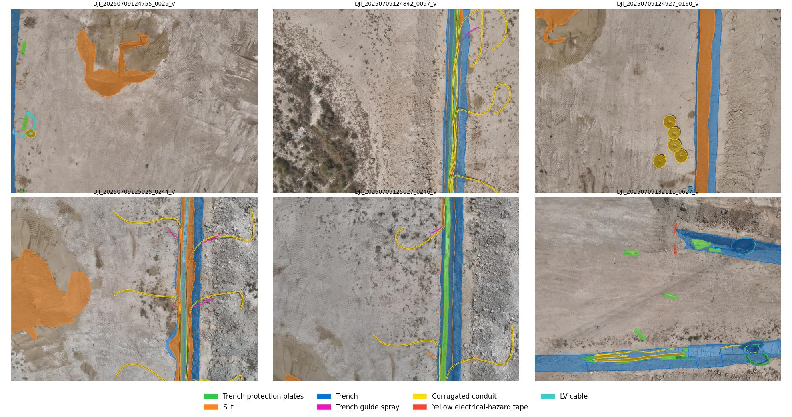
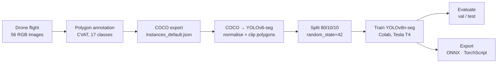
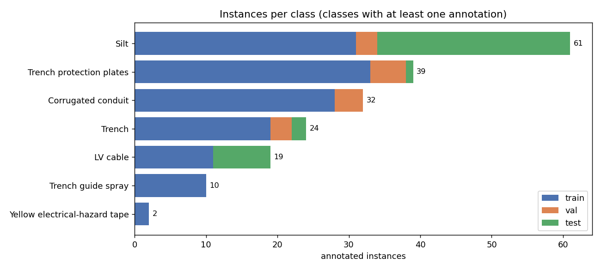
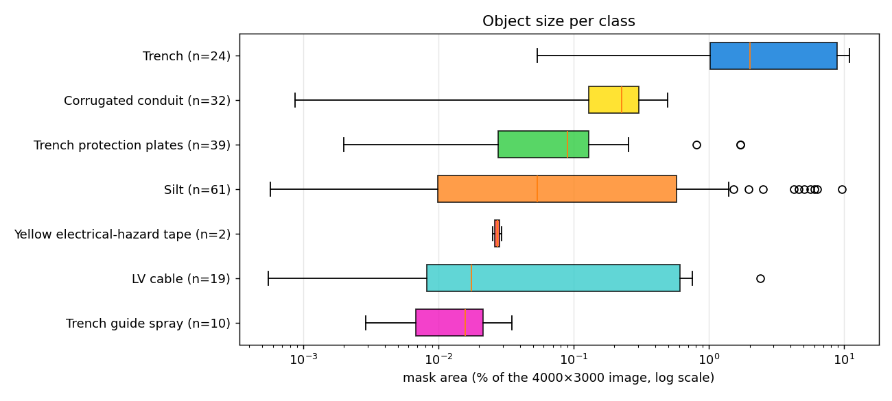
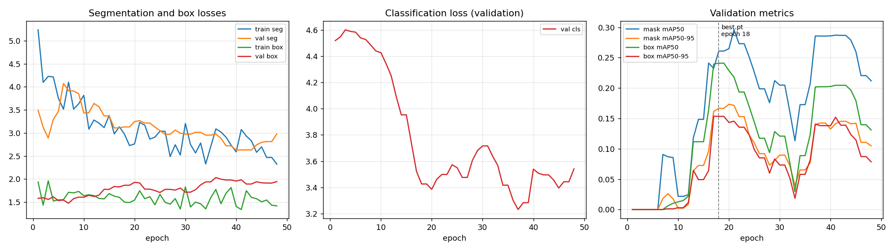
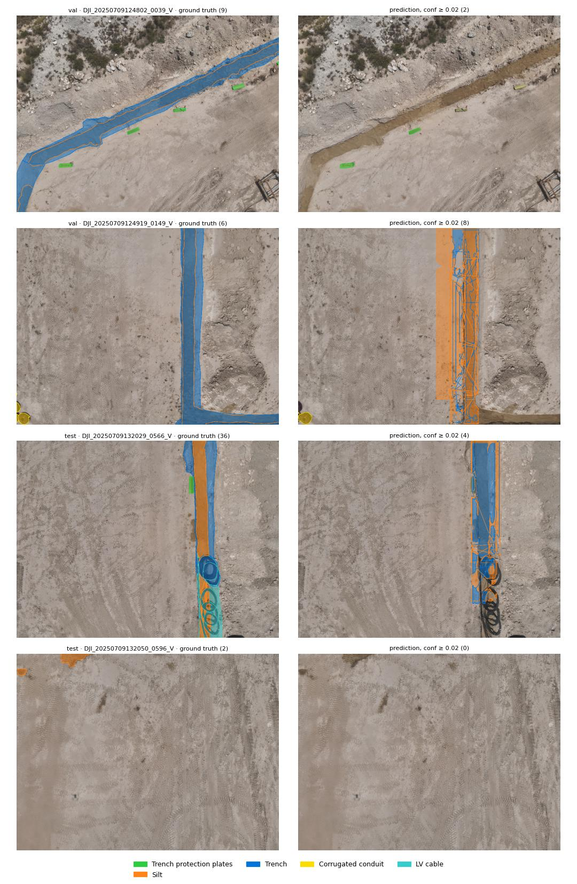

# ZANJAS GARMI · Instance segmentation of cable-trench construction elements from drone imagery

Instance segmentation of aerial drone images to identify the elements involved in **electrical cable trench works** (*zanjas* in Spanish): the trench itself, excavated silt, corrugated conduits, trench protection plates, low-voltage cable, guide spray markings and electrical-hazard warning tape.

The project covers the whole pipeline: polygon annotation in CVAT, COCO → YOLOv8-seg conversion, a reproducible train/val/test split, training a YOLOv8n-seg model in Google Colab, evaluation and export to ONNX and TorchScript.

<p align="center">
  
  <br><em>Training images with their annotated masks.</em>
</p>

---

## Table of contents

- [Project at a glance](#project-at-a-glance)
- [Repository structure](#repository-structure)
- [Pipeline](#pipeline)
- [Dataset](#dataset)
- [Model and training](#model-and-training)
- [Results](#results)
- [Discussion](#discussion)
- [Future work](#future-work)

---

## Project at a glance

| | |
|---|---|
| Task | Instance segmentation (polygon masks) |
| Imagery | RGB drone images, DJI `M3T` camera, 4000 × 3000 px |
| Image capture | 9 July 2025 |
| Model training | 2 September 2025 |
| Annotation tool | CVAT (COCO export) |
| Model | YOLOv8n-seg (Ultralytics), ≈3.26 M parameters, 12 GFLOPs |
| Environment | Google Colab · Tesla T4 GPU · Ultralytics 8.3.191 · PyTorch 2.8.0 · Python 3.12 |
| Best validation result | mask mAP50 **0.261**, mask mAP50-95 **0.167** |
| Exported formats | PyTorch (`.pt`), ONNX, TorchScript |

## Repository structure

```
ZANJAS_GARMI/
├── notebooks/
│   └── GARMI_Zanjas.ipynb              # full Colab workflow: conversion, split, training, inference
├── dataset/
│   ├── images/{train,val,test}/        # RGB drone images (4000×3000)
│   ├── labels/{train,val,test}/        # YOLO-seg labels (normalised polygons)
│   ├── annotations/
│   │   ├── instances_default_cvat.json # full COCO export from CVAT (56 images)
│   │   └── {train,val,test}_annotations.json
│   ├── data.yaml                       # dataset config with relative paths
│   └── data_colab_original.yaml        # original config used in Google Colab
├── models/
│   └── zanjas_cableado_20250902_035309/
│       ├── best.pt                     # best weights (PyTorch, 6.8 MB)
│       ├── last.pt                     # last-epoch weights
│       ├── best.onnx                   # ONNX export (13 MB)
│       ├── best.torchscript.zip        # TorchScript export (14 MB)
│       ├── results.csv                 # per-epoch losses and metrics
│       └── data.yaml
├── scripts/
│   ├── make_figures.py                 # training curves, class statistics, annotation mosaic
│   └── predict_test.py                 # ground truth vs. prediction comparison
└── assets/                             # README figures
```

## Pipeline



The whole workflow lives in [`notebooks/GARMI_Zanjas.ipynb`](notebooks/GARMI_Zanjas.ipynb):

1. **Annotation.** Polygons were drawn in CVAT over the drone images and exported in COCO format.
2. **COCO → YOLOv8-seg conversion.** Each instance becomes one line `<class_id> x1 y1 x2 y2 …`, with coordinates normalised to [0, 1] and clipped to the image border. RLE / `iscrowd` annotations and segments with negligible area are skipped, and multi-polygon instances are concatenated on the same line. COCO category ids 1–17 are mapped to YOLO indices 0–16, and images without annotations get an empty `.txt` (background images).
3. **Split.** `train_test_split` with `random_state=42` gives an 80/10/10 split. A COCO file is written per split, along with the `data.yaml`.
4. **Sanity checks.** The notebook checks for missing or extra label files, counts empty labels and instances per class, and plots random samples with their masks.
5. **Training and validation** of YOLOv8n-seg, followed by validation of `best.pt`.
6. **Saving and inference.** The model is copied to Google Drive and run on validation images.

## Dataset

### Splits

| Split | Images | Images with annotations | Instances |
|---|---|---|---|
| train | 44 | 10 | 134 |
| val | 6 | 2 | 15 |
| test | 6 | 2 | 38 |
| **total** | **56** | **14** | **187** |

Annotated images contain 13.4 instances on average (minimum 1, maximum 36).

### Classes

The annotation schema defines 17 classes; the original labels are in Spanish and are kept as-is in `data.yaml`. Seven of them have annotated instances:

| ID | Original label | English | Instances | Images | Median mask area (% of image) |
|---|---|---|---|---|---|
| 7 | Limo | Silt | 61 | 11 | 0.054 |
| 5 | Placas protección zanja | Trench protection plates | 39 | 10 | 0.090 |
| 13 | Tubo corrugado | Corrugated conduit | 32 | 7 | 0.225 |
| 10 | Zanja | Trench | 24 | 12 | 2.009 |
| 16 | cable BT | LV (low-voltage) cable | 19 | 3 | 0.018 |
| 11 | Spray guía zanja | Trench guide spray marking | 10 | 4 | 0.016 |
| 15 | cinta amarilla de riesgo electrico | Yellow electrical-hazard tape | 2 | 1 | 0.027 |

The remaining 10 classes are defined in the schema but have no annotations yet:

| ID | Original label | English |
|---|---|---|
| 0 | Poste | Pole |
| 1 | Puerta de acceso | Access gate |
| 2 | Placa Avifauna | Bird-protection plate |
| 3 | Malla valla | Fence mesh |
| 4 | Paso de fauna | Wildlife crossing |
| 6 | Arquetas | Junction boxes |
| 8 | Cable MT | MV (medium-voltage) cable |
| 9 | Contenedor | Container |
| 12 | Bobinas | Cable reels |
| 14 | cable de cobre desnudo | Bare copper cable |

<p align="center">
  
</p>

### Object size

Most objects are very small relative to the 12-megapixel frame. Apart from *Trench*, every class has a median mask area below 0.25 % of the image, and cables, spray marks and tape are thin, elongated shapes covering a few hundredths of a percent.

<p align="center">
  
</p>

## Model and training

- **Architecture:** YOLOv8n-seg, initialised from COCO-pretrained `yolov8n-seg.pt` weights; 381 of 417 weight tensors were transferred.
- **Input size:** 1024 px. The 4000 × 3000 images are resized to 1024 × 768.
- **Optimiser:** `optimizer=auto`, which Ultralytics resolved to **AdamW (lr = 0.000476, momentum = 0.9)**. Because of this, the `lr0=0.01` passed explicitly was ignored.
- **Early stopping:** patience 30. Training stopped at **epoch 48 of 150**, and `best.pt` corresponds to **epoch 18**, the best Ultralytics fitness (0.1·mAP50 + 0.9·mAP50-95, summed over box and mask).
- **Training time:** 48 epochs in 0.044 h (≈2.6 min) on a Tesla T4 with mixed precision (AMP).

| Hyperparameter | Value | Hyperparameter | Value |
|---|---|---|---|
| `epochs` | 150 | `imgsz` | 1024 |
| `patience` | 30 | `batch` | 8 |
| `cos_lr` | True | `lrf` | 0.01 |
| `mosaic` | 0.7 | `close_mosaic` | 10 |
| `translate` | 0.05 | `scale` | 0.5 |
| `fliplr` | 0.5 | `flipud` | 0.0 |
| `hsv_h / hsv_s / hsv_v` | 0.015 / 0.7 / 0.4 | `degrees / shear` | 0.0 / 0.0 |
| `workers` | 2 | `seed` | 0 (deterministic) |

Training call from the notebook:

```python
model = YOLO("yolov8n-seg.pt")
model.train(data=data_yaml, imgsz=1024, epochs=150, patience=30, batch=8,
            lr0=0.01, lrf=0.01, cos_lr=True,
            hsv_h=0.015, hsv_s=0.7, hsv_v=0.4, degrees=0.0, translate=0.05,
            scale=0.5, shear=0.0, flipud=0.0, fliplr=0.5, mosaic=0.7, workers=2)
```

### Training dynamics

<p align="center">
  
</p>

- **Epochs 1–6:** all validation metrics stay at zero while the model adapts from the COCO classes.
- **Epochs 13–21:** the metrics rise to their first peak, with mask mAP50 around 0.26–0.30.
- **Later epochs:** training losses keep decreasing, but validation box loss rises from ≈1.5 to ≈1.95 and the metrics oscillate. This is a clear sign of overfitting to the 10 annotated training images.
- **Step-like curves:** the validation set has only 15 instances, so a single detection changing moves the metric noticeably.

## Results

### Overall metrics (`best.pt`, `imgsz=1024`)

| Split | Images (annotated) | Instances | Mask mAP50 | Mask mAP50-95 | Box mAP50 | Box mAP50-95 |
|---|---|---|---|---|---|---|
| val | 6 (2) | 15 | **0.261** | **0.167** | 0.241 | 0.149 |
| test | 6 (2) | 38 | 0.258 | 0.252 | 0.410 | 0.169 |

The validation figures match the training log in the notebook and the metrics stored in the checkpoint.

### Per-class results (mask)

**Validation**

| Class | Instances | Recall | mAP50 | mAP50-95 |
|---|---|---|---|---|
| Trench protection plates | 5 | 0.80 | 0.801 | 0.567 |
| Corrugated conduit | 4 | 0.50 | 0.129 | 0.087 |
| Silt | 3 | 0.33 | 0.113 | 0.011 |
| Trench | 3 | 0.00 | 0.000 | 0.000 |

**Test**

| Class | Instances | Recall | mAP50 | mAP50-95 |
|---|---|---|---|---|
| Trench protection plates | 1 | 1.00 | 0.995 | 0.995 |
| Silt | 27 | 0.07 | 0.039 | 0.014 |
| Trench | 2 | 0.00 | 0.000 | 0.000 |
| LV cable | 8 | 0.00 | 0.000 | 0.000 |

### Inference speed

| Hardware | Inference per image (1024 px) |
|---|---|
| Tesla T4 GPU (Colab, validation run) | 10.7 ms |
| CPU, AMD Ryzen 5 7430U | 144.6 ms |

### Qualitative results

The comparison below covers the four annotated images in the validation and test splits. The model's confidence scores are low: with the default threshold (`conf=0.25`) it returns no detections, which the notebook's own inference cells also show. The predictions are therefore drawn at `conf ≥ 0.02`.

<p align="center">
  
</p>

- **Trench protection plates** are the best-learned class. They are compact objects with a consistent shape and colour, and the model finds them at the right locations.
- **The trench area** is located, but it is often labelled as *Silt*: both are long strips of excavated earth with very similar texture.
- **Thin structures** such as LV cable, conduits and spray marks are not separated. At 1024 px input each object is only a few pixels wide.
- **Image `…0596`:** its only two annotations are small silt patches at the border of the frame, and none are detected.

## Discussion

The pipeline is complete and reproducible, from CVAT annotations to exported models, but the model is still a **proof of concept**. Its performance is limited by the data rather than by the training setup:

- **Annotation coverage.** Only 14 of the 56 images (25 %) are annotated, and 10 of the 17 classes have no examples, so the model cannot learn them.
- **Class imbalance.** *Silt* and *Trench protection plates* account for over half of all instances; *Yellow electrical-hazard tape* has only 2.
- **Scale.** Downscaling 4000 × 3000 frames to 1024 px makes cables, conduits and tape almost invisible to the network.
- **Small evaluation sets.** Two annotated images per split mean that val and test metrics have very high variance and should be read as indicative only.
- **Overfitting.** The validation losses start rising after the first peak, so more data, rather than longer training, is needed.

## Future work

- Annotate the remaining 42 images and add examples for the 10 empty classes.
- Tile the full-resolution images (for example 1024 × 1024 crops with overlap) so that thin objects keep their detail, and stitch the predictions back together.
- Merge or redefine visually ambiguous classes (*Trench* vs. *Silt*) or add contextual rules.
- Try larger backbones (`yolov8s-seg`, `yolov8m-seg`) once there is more data, and use k-fold cross-validation for more reliable metrics.
- Calibrate the confidence threshold per class for deployment.

---

The figures in `assets/` are generated from the repository data with `scripts/make_figures.py` and `scripts/predict_test.py`.

**Author:** Alexis Rojas
